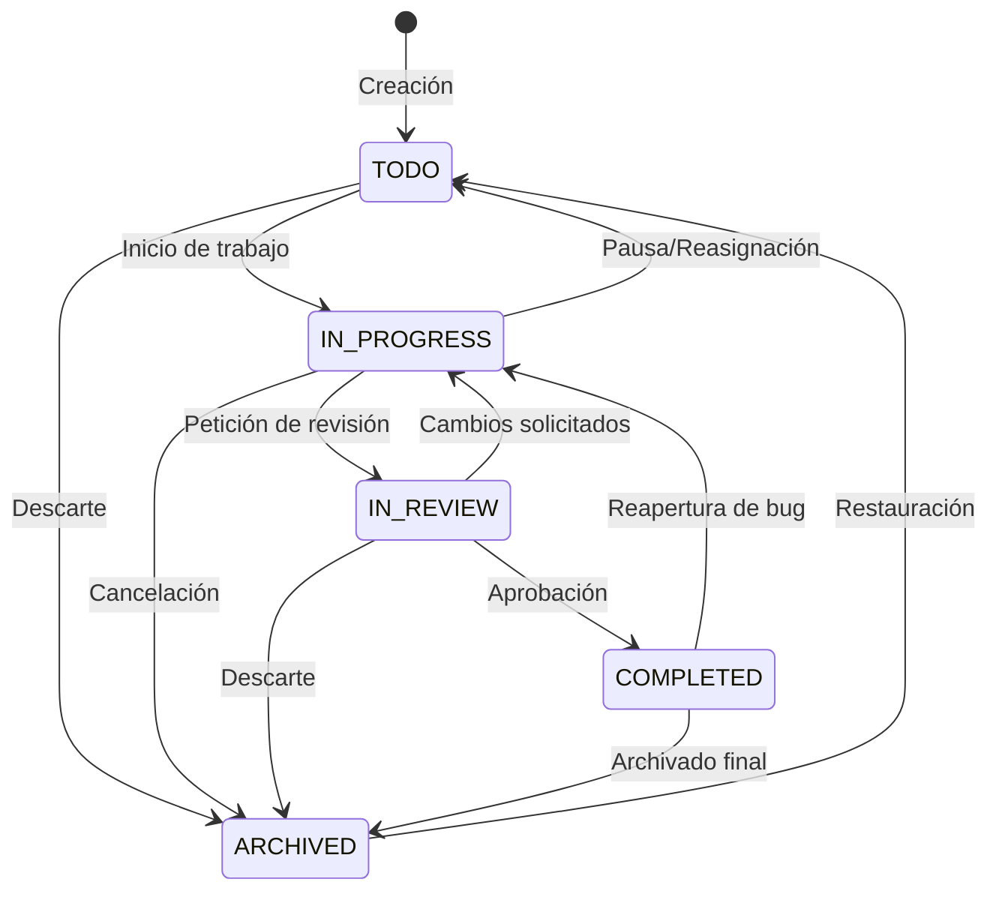

# Arquitectura del Sistema - TaskSphere Enterprise API

## 1. Visión General y Principios de Diseño
Este proyecto implementa los principios de **Clean Architecture** (Arquitectura Limpia) y **Domain-Driven Design (DDD)** adaptados al ecosistema Python moderno.

```
       +-------------------------------------------------------+
       |                  Clientes Externos                   |
       |           (Web UI, Mobile, curl, Postman)             |
       +---------------------------+---------------------------+
                                   | HTTP / JSON / OAuth2
                                   v
+---------------------------------------------------------------------+
| Capa de Presentación (src/enterprise_api/api/)                       |
|  - Routers de endpoints v1 (/auth, /users, /projects, /tasks)      |
|  - Inyección de dependencias (deps.py)                              |
|  - Middleware de correlación (X-Request-ID, X-Process-Time)         |
+----------------------------------+----------------------------------+
                                   |
                                   v
+---------------------------------------------------------------------+
| Capa de Servicios de Dominio (src/enterprise_api/services/)          |
|  - AuthService, UserService, ProjectService, TaskService            |
|  - Máquina de estados finitos (FSM) de tareas                        |
|  - Generación de slug seguro y validación de reglas de negocio       |
|  - Registro automático de auditoría (AuditLog)                      |
+----------------------------------+----------------------------------+
                                   |
                                   v
+---------------------------------------------------------------------+
| Capa de Repositorios (src/enterprise_api/repositories/)              |
|  - BaseRepository[Model] (CRUD genérico asíncrono)                  |
|  - UserRepository, ProjectRepository, TaskRepository, AuditRepo     |
|  - Consultas especializadas con eager-loading (selectinload)        |
+----------------------------------+----------------------------------+
                                   |
                                   v
+---------------------------------------------------------------------+
| Capa de Infraestructura y Datos (src/enterprise_api/models & core/) |
|  - SQLAlchemy 2.0 Async Engine (SQLite / PostgreSQL)                |
|  - Migración y seed automático de tablas (lifespan)                 |
|  - Modelos ORM: User, Project, Task, AuditLog                       |
+---------------------------------------------------------------------+
```

---

## 2. Las 3 Inspiraciones de Proyectos de GitHub

### 🌟 1. `tiangolo/full-stack-fastapi-template` y `tiangolo/fastapi`
- **Estructura Modular de Endpoints y Routers**: Separación limpia entre rutas (`/api/v1`), inyección de dependencias (`Depends`), y ciclo de vida de la aplicación (`lifespan` asíncrono).
- **Seguridad y RBAC**: Autenticación Bearer JWT estándar con soporte nativo para Swagger UI (`OAuth2PasswordBearer` + `OAuth2PasswordRequestForm`).
- **Control de Roles**: Guards declarativos (`require_admin`, `require_manager_or_admin`).
- **Seed Inicial**: Inicialización automática y segura del superusuario administrador durante el arranque.

### ⚡ 2. `encode/httpx` y `encode/starlette`
- **Manejo de Errores RFC 7807/9457**: Jerarquía de excepciones (`AppException`, `NotFoundError`, `ConflictError`, `ForbiddenError`, `ValidationError`) con respuestas JSON estructuradas con código de error, mensaje y detalle legible por máquinas.
- **Trazabilidad y Rendimiento**: Middleware que inyecta encabezados `X-Request-ID` para correlación de logs y `X-Process-Time` para monitorización de latencia en milisegundos.
- **Fixtures Asíncronas**: Pruebas con `httpx.AsyncClient` y `ASGITransport` para pruebas End-to-End sin abrir sockets de red externos.

### 🛡️ 3. `pydantic/pydantic` y `astral-sh/ruff`
- **Validación Tipada Estricta**: Modelos Pydantic V2 con `ConfigDict(from_attributes=True)` y esquemas genéricos paginados `PaginatedResponse[T]`.
- **Configuración Basada en Entorno**: `pydantic-settings` con lectura de `.env`, validación de orígenes CORS y tipado fuertemente acotado (`Literal`).
- **Tooling de Primera Clase**: Configuración centralizada en `pyproject.toml` (PEP 621), linter ultra-rápido Ruff, y suite de pruebas con Pytest y reporte de cobertura de código.

---

## 3. Máquina de Estados del Flujo de Trabajo (Tasks)

Para evitar estados incoherentes en proyectos empresariales, las tareas siguen una máquina de estados finitos (FSM) estricta:


Cualquier transición ilegal (por ejemplo, saltar de `TODO` directamente a `COMPLETED`) es rechazada con un código `422 Unprocessable Content` y un mensaje descriptivo de las transiciones permitidas.
