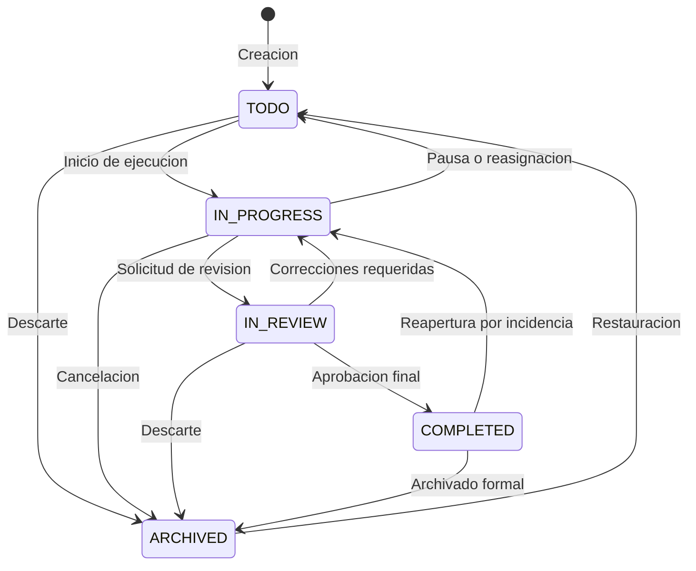

# Arquitectura del Sistema - TaskSphere Enterprise API

## 1. Vision General y Principios de Diseno

Este proyecto implementa los principios de Arquitectura Limpia (Clean Architecture) y Diseno Guiado por el Dominio (DDD) aplicados sobre el ecosistema Python asincrono moderno.

```text
       +-------------------------------------------------------+
       |                  Clientes Externos                   |
       |           (Web UI, Mobile, curl, Postman)             |
       +---------------------------+---------------------------+
                                   | HTTP / JSON / OAuth2
                                   v
+---------------------------------------------------------------------+
| Capa de Presentacion (src/enterprise_api/api/)                       |
|  - Routers de endpoints v1 (/auth, /users, /projects, /tasks)      |
|  - Inyeccion de dependencias (deps.py)                              |
|  - Middleware de correlacion (X-Request-ID, X-Process-Time)         |
+----------------------------------+----------------------------------+
                                   |
                                   v
+---------------------------------------------------------------------+
| Capa de Servicios de Dominio (src/enterprise_api/services/)          |
|  - AuthService, UserService, ProjectService, TaskService            |
|  - Maquina de estados finitos (FSM) de tareas                        |
|  - Generacion deterministica de slug y validacion de reglas          |
|  - Registro automatico de auditoria (AuditLog)                      |
+----------------------------------+----------------------------------+
                                   |
                                   v
+---------------------------------------------------------------------+
| Capa de Repositorios (src/enterprise_api/repositories/)              |
|  - BaseRepository[Model] (CRUD generico asincrono)                  |
|  - UserRepository, ProjectRepository, TaskRepository, AuditRepo     |
|  - Consultas especializadas con carga ansiosa (selectinload)        |
+----------------------------------+----------------------------------+
                                   |
                                   v
+---------------------------------------------------------------------+
| Capa de Infraestructura y Datos (src/enterprise_api/models & core/) |
|  - SQLAlchemy 2.0 Async Engine (SQLite / PostgreSQL)                |
|  - Migracion y seed automatico de tablas (lifespan)                 |
|  - Modelos ORM: User, Project, Task, AuditLog                       |
+---------------------------------------------------------------------+
```

---

## 2. Maquina de Estados del Flujo de Trabajo (Tasks)

Para evitar estados inconsistentes en la orquestacion de tareas, las entidades siguen una maquina de estados finitos (FSM) estricta:



Cualquier transicion no contemplada en la matriz permitida es rechazada de manera inmediata con un codigo de estado `422 Unprocessable Content` y un detalle legible bajo la especificacion RFC 7807/9457 indicando los estados validos para el contexto actual.

---

## 3. Trazabilidad y Observabilidad

El middleware `CorrelationAndTimingMiddleware` garantiza que:
1. Toda peticion HTTP reciba o preserve un identificador `X-Request-ID` unico (UUIDv4).
2. Se registre el tiempo de ejecucion en el encabezado de respuesta `X-Process-Time`.
3. Los errores no controlados se registren en el log estructurado junto al `request_id` correspondiente para facilitar el rastreo en herramientas APM.
